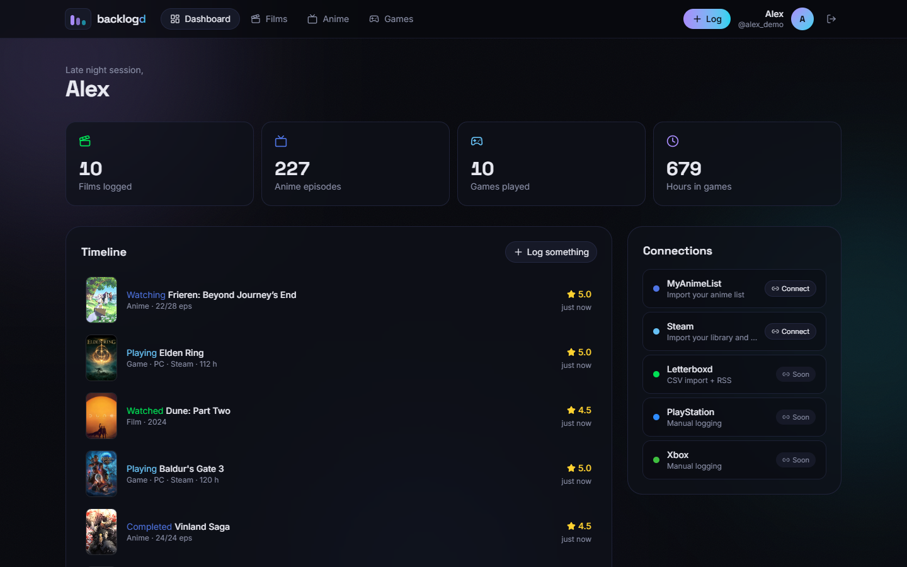
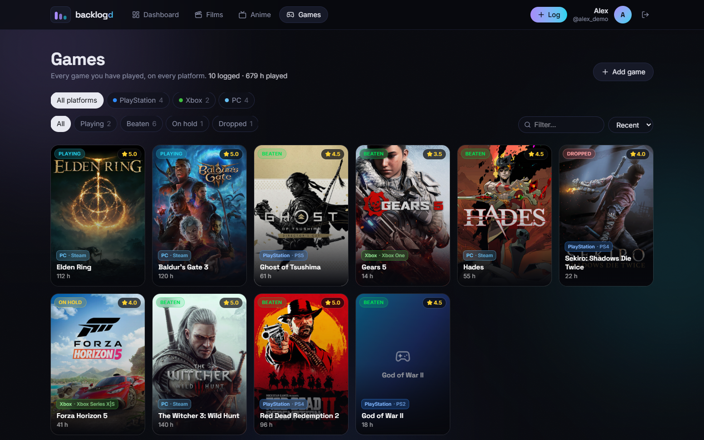
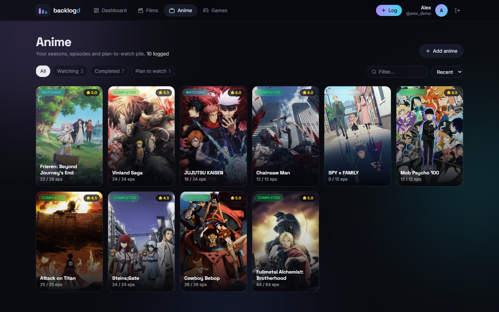
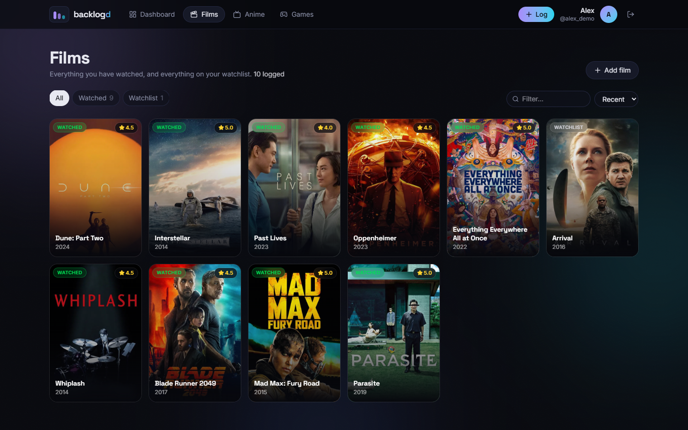
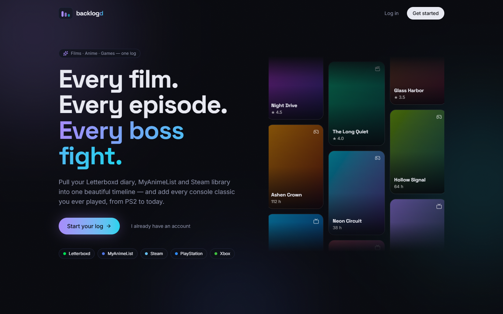
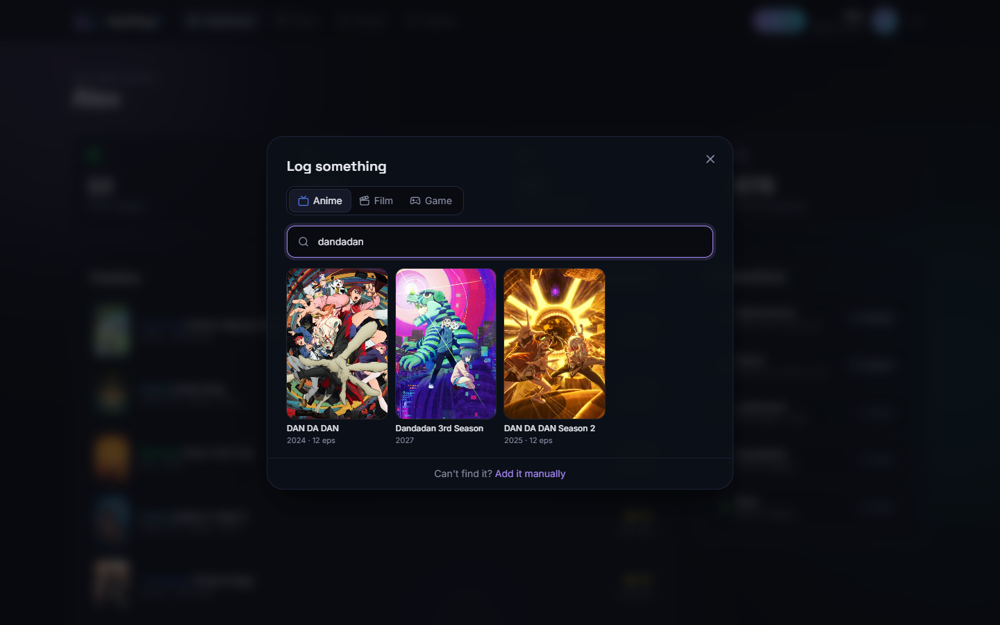
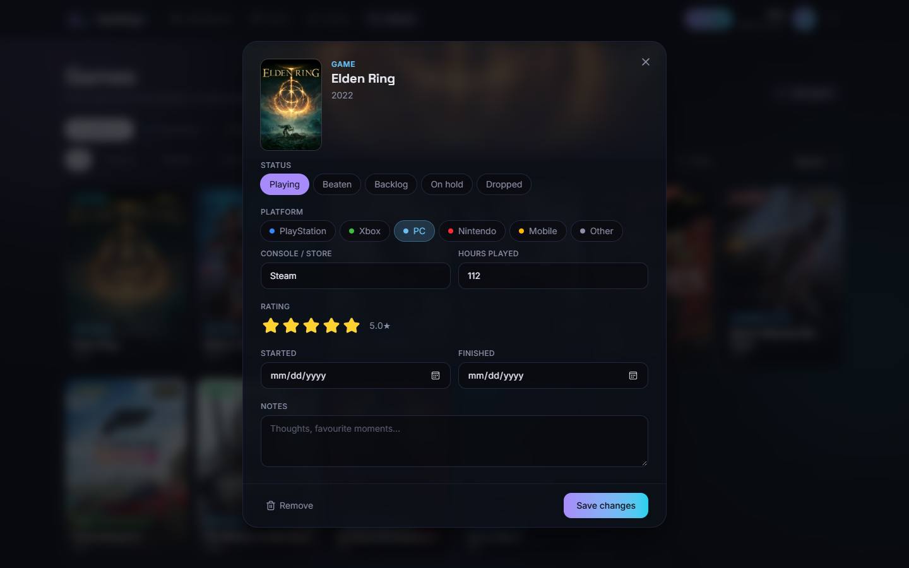
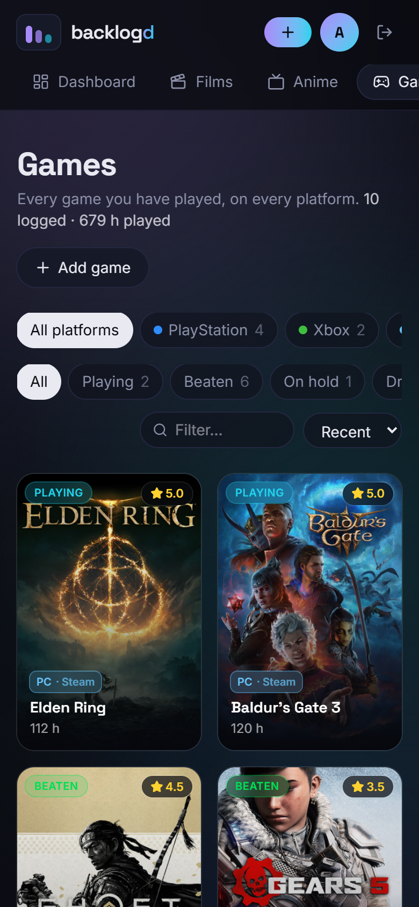

# Backlogd

**One log for every film, anime and game.** Search titles from TMDB and AniList, import your MyAnimeList and Steam libraries, and add everything else you've played by hand, from PS2 classics to this week's release. Each entry gets a poster card, a status, a rating and your progress.



## Screenshots

| Games across every platform | Anime |
|---|---|
|  |  |

| Films | Landing page |
|---|---|
|  |  |

| Search AniList / TMDB | Log or edit an entry |
|---|---|
|  |  |

<p align="center"></p>

## Features

- **Accounts:** sign-up and login with JWT tokens. Each user has a separate log.
- **Films:** search TMDB, then rate (half-star steps), log watch dates and add notes.
- **Anime:** search AniList and track episodes. Completing a show fills in its episode count.
- **Games:** one page for every platform (PlayStation, Xbox, PC, Nintendo…) with the console (PS2, Xbox 360, Steam…) and hours played. Filter by platform and status.
- **MyAnimeList import:** import a public list by username. Titles are matched to AniList so they share artwork. Status, scores, episodes and dates carry over, and syncing again never creates duplicates.
- **Steam import** *(beta)*: owned games and playtime, with Steam cover art. Status comes from playtime: played in the last 2 weeks is *Playing*, played earlier is *On hold*, never launched is *Backlog*. Syncing again refreshes hours.
- **Dashboard:** totals, a timeline of recent activity and connected accounts.
- A dark, poster-first UI that works on desktop and phone.

## Tech stack

| | |
|---|---|
| **Backend** | Java 21 · Spring Boot 4 · Spring Security (OAuth2 resource server, HS256 JWT) · Spring Data JPA / Hibernate 7 · Flyway · PostgreSQL |
| **Frontend** | React 19 · TypeScript · Vite 6 · Tailwind CSS 4 · TanStack Query · React Router 7 · Motion · Lucide |
| **External APIs** | TMDB (films) · AniList GraphQL (anime) · MyAnimeList v2 (list import) · Steam Web API (library import) |

## API

Every endpoint except register and login needs an `Authorization: Bearer <token>` header. Errors use [RFC 9457 problem details](https://www.rfc-editor.org/rfc/rfc9457). Validation errors also include an `errors` array with one entry per field.

### Auth

| Method | Path | Description |
|---|---|---|
| `POST` | `/api/auth/register` | `{email, username, displayName?, password}` → `{token, user}` |
| `POST` | `/api/auth/login` | `{email, password}` → `{token, user}` |
| `GET` | `/api/me` | The current user |

### Catalog search

| Method | Path | Description |
|---|---|---|
| `GET` | `/api/search?kind=ANIME\|FILM&q=…` | Search AniList (anime) or TMDB (films) |
| `GET` | `/api/search/sources` | Which kinds can be searched right now, e.g. `{FILM: true, ANIME: true, GAME: false}` |

### Log entries

| Method | Path | Description |
|---|---|---|
| `GET` | `/api/logs?kind=FILM\|ANIME\|GAME` | The user's entries, most recently updated first (`kind` is optional) |
| `POST` | `/api/logs` | Create an entry: `{media: {source, externalId}` *or* `{source: "MANUAL", kind, title, year?, posterUrl?}, status, rating?, platform?, console?, progress?, hours?, startedOn?, finishedOn?, notes?}` |
| `PUT` | `/api/logs/{id}` | Update an entry (same fields, without `media`) |
| `DELETE` | `/api/logs/{id}` | Remove an entry |

`status` is one of `PLANNED`, `IN_PROGRESS`, `COMPLETED`, `PAUSED` or `DROPPED`. `platform` (required for games) is one of `PLAYSTATION`, `XBOX`, `PC`, `NINTENDO`, `MOBILE` or `OTHER`.

### Connections and imports

| Method | Path | Description |
|---|---|---|
| `GET` | `/api/connections` | Linked accounts and which providers the server is configured for |
| `POST` | `/api/connections/mal/import` | `{username}`: link the account and import (or re-sync) a public MAL anime list |
| `POST` | `/api/connections/steam/import` | `{profile}`: a profile link, SteamID or custom URL. Imports or re-syncs a Steam library |
| `DELETE` | `/api/connections/{MAL\|STEAM}` | Unlink the account. Imported entries stay |

## Running locally

**Requirements:** JDK 21, Node 22 and PostgreSQL. Maven is included through the Maven Wrapper.

1. **Configure the backend.** Copy `backend/.env.example` to `backend/.env` and fill it in:

   | Key | Required | Where to get it |
   |---|---|---|
   | `DB_USERNAME`, `DB_PASSWORD` | ✅ | Your PostgreSQL login. Tables are created in a `backlogd` schema on first start |
   | `JWT_SECRET` | ✅ | Any base64 value of 32 bytes or more (the example file shows how to generate one) |
   | `TMDB_API_KEY` | for film search | [themoviedb.org → Settings → API](https://www.themoviedb.org/settings/api) |
   | `MAL_CLIENT_ID` | for MAL import | [myanimelist.net/apiconfig](https://myanimelist.net/apiconfig) |
   | `STEAM_API_KEY` | for Steam import | [steamcommunity.com/dev/apikey](https://steamcommunity.com/dev/apikey) |

   `backend/.env` is git-ignored. Without the optional keys, the matching feature is switched off and the UI explains what's missing.

2. **Start the API** at http://localhost:8080:
   ```bash
   cd backend
   ./mvnw spring-boot:run
   ```

3. **Start the web app** at http://localhost:5173. The Vite dev server forwards `/api` to the backend:
   ```bash
   cd frontend
   npm install
   npm run dev
   ```

## Roadmap

- [ ] Letterboxd import (CSV export + RSS)
- [ ] IGDB search for console games
- [ ] Stats page and a yearly "Wrapped" recap
- [ ] Public profile pages

## Credits

Film data and images come from [TMDB](https://www.themoviedb.org/). This product uses the TMDB API but is not endorsed or certified by TMDB. Anime data comes from [AniList](https://anilist.co/) and [MyAnimeList](https://myanimelist.net/), and game library data and artwork from [Steam](https://store.steampowered.com/). Backlogd is not affiliated with any of these services.
